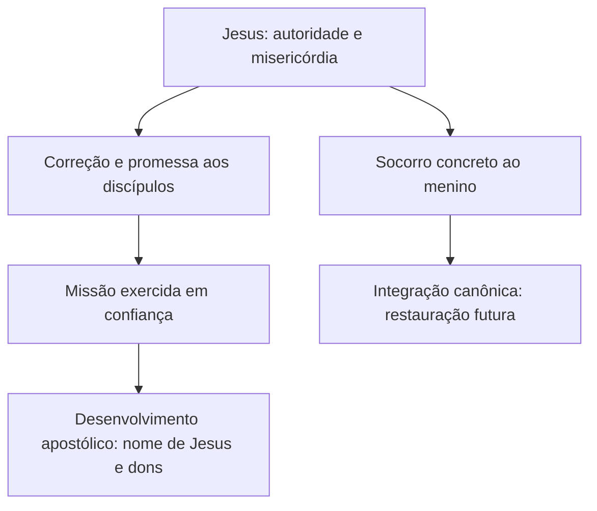

# EXE-12B — Integração canônica temática de Mateus17.14–20

Data:26/10/2026. Entrada: EXE-11–12 e avaliação10B, com CTL-01 aplicado. Preserva problema e ideia,sem converter a fase temática em sistemática ou aplicação. Raiz canônica,paralelo temático,alusão e cumprimento são relações diferentes. As passagens adicionais aqui selecionadas ampliam a comparação,sem alterar retroativamente o léxico ou a tradução de17.

## 1. Temas e hierarquia

| Tema | Evidência de17 | Lugar no argumento |
|---|---|---|
| Misericórdia | Pedido15 e socorro18 | A necessidade recebe resposta efetiva |
| Autoridade de Jesus | Repreensão,expulsão,cura18 | Contraste entre mestre e discípulos |
| Fé | Deficiência20 e promessa | Explicação e instrução |
| Missão dependente | Fracasso16/19 lido com10.1,8 | Comissão não produz autonomia |
| Reino/restauração | Classificação contextual por12.28 | Horizonte mais amplo,grau Moderado |

Censura e formação são relações ativas desses temas. Igreja e consumação são desenvolvimento posterior; não termos locais. Jejum não entra como eixo de17.14–20,a partir da decisão textual.

## 2. Raízes significativas: sem alegação de primeira ocorrência absoluta

### Fé: Gênesis15.1–6

Abrão recebe promessa em circunstância de ausência de descendente e crê no Senhor. A contribuição é a orientação da fé para Deus e sua palavra. A passagem tem situação e promessa próprias. Não igualar esse ato a dom de milagres nem deduzir transferência de qualquer promessa patriarcal aos discípulos.

### Misericórdia e missão: Êxodo3.7–12 e34.6–7

Êxodo3 relaciona sofrimento do povo,intervenção divina,envio de Moisés e promessa de presença. Êxodo34 apresenta misericórdia e fidelidade sem eliminar responsabilidade pelo mal. São raízes para a integração temática,sem evidência de citação específica em17.14–20. Não equiparar o demônio a faraó ou o menino a Israel.

### Infidelidade: Deuteronômio32.5,20

A relação literária provável já avaliada09 permite reconhecer linguagem escriturística de censura em17.17. Não importar todo o cântico nem concluir rejeição étnica definitiva. Grau Moderado para intenção alusiva.

Esses textos são pontos representativos de desenvolvimento;não se afirmou que nenhuma evidência anterior existe. Ordem canônica não é cronologia simplificada da composição de cada livro.

## 3. Desenvolvimento por conjuntos canônicos

| Conjunto | Texto selecionado | Contribuição | Limite da relação com17 |
|---|---|---|---|
| Pentateuco | Gn15;Êx3;34;Dt32 | Confiança,promessa,misericórdia,envio,censura | Raízes temáticas;Dt32 alusão provável |
| Históricos | 2Rs4.29–35 | Cajado levado por Geazi não soluciona;Eliseu ora e a criança revive | Comparação de falha e intervenção,não tipo demonstrado do grupo |
| Salmos/poesia | Sl103.1–13 | Louvor por benefícios,perdão,cura e compaixão | Linguagem de louvor,não calendário universal de cada cura |
| Profetas | Is35.4–6 | Esperança de socorro divino e restauração corporal | Não tornar cada condição deste catálogo descrição mateana do menino |
| Evangelhos | Mt8.16–17;10.1,8;12.28;17;28.18–20 | Obras de Jesus,comissão,Reino,formação e envio | Formulação própria de cada episódio preservada |
| Atos | At3.12–16 | Eficácia atribuída a Jesus,sem poder próprio dos agentes | Cura distinta após ressurreição;sem dependência literária de17 provada |
| Epístolas | 1Co12;2Co12;Hb11;Tg5;1Jo5.14 | Dons,oração,fidelidade em aflição e vontade divina | Integração já10B;sem diagnóstico uniforme |
| Apocalipse | Ap21.4 | Horizonte do fim do sofrimento e morte | Consumação,não descrição da cura como glorificação |

2Rs4 é comparação temática representativa de narrativa histórica. A criança revive naquele contexto;em17 a cura não é descrita como ressurreição. A passagem não estabelece que discípulos sejam Geazi nem que Jesus seja apenas um novo Eliseu. A leitura local funciona sem essa comparação: grau Baixo para tipologia específica.

Sl103 relaciona benefícios divinos e compaixão na forma de louvor. Não converter sua enumeração em contrato de resultado imediato para cada fiel. A relação com o pedido de misericórdia é temática Moderada,sem alusão verbal demonstrada.

## 4. Textos-chave e ampliação cristológica

### Mateus8.16–17 e Isaías

Mt8.16–17 reúne expulsões e curas e apresenta uma fórmula explícita de cumprimento com Isaías. Isso fornece no próprio livro uma classificação profética do ministério de socorro. Não significa que17 cite diretamente Is53 nem que contenha outra fórmula de cumprimento. A distinção permite relacionar a cena ao Messias sem inventar citação local.

Is35.4–6 associa o socorro esperado de Deus à restauração corporal. Sua relação com17 é contextual e temática. A comparação não introduz em Mateus a surdez e mudez relatadas em Marcos como se fossem palavras presentes no relato mateano.

### Atos3.12–16

Pedro rejeita que a cura se explique por poder ou piedade próprios e a relaciona a Jesus. A continuidade com17 está na dependência dos enviados; o desenvolvimento histórico é a atuação em nome do ressuscitado. Não reconstituir o fracasso anterior como confiança no poder próprio apenas porque Atos adverte contra essa interpretação da cura.

### 1Coríntios12 e oração

Na Igreja apostólica,a distribuição dos dons não é uniforme. Tg5 convoca atuação comunitária e oração;1Jo5.14 relaciona confiança e vontade divina. Esses textos não tornam a fé irrelevante nem a definem como energia. Hb11 e2Co12 impedem equacionar toda fidelidade com ausência de sofrimento. A relação foi avaliada10B;este módulo a organiza na rede temática.

## 5. Mapa conceitual e relações

As três primeiras relações organizam o acontecimento e seu contexto;as duas últimas articulam desenvolvimento posterior com grau Moderado. Nenhuma seta significa causalidade automática,alusão verbal ou identidade de função em todas as épocas.

| Relação | O que pressupõe ou articula | O que não implica |
|---|---|---|
| Misericórdia→socorro | Sofrimento real e intervenção de Jesus | Aprovação prévia de todos os envolvidos |
| Autoridade→missão | Envio e capacitação concedidos | Poder autônomo do enviado |
| Fé→dependência | Confiança dirigida ao Senhor no contexto | Medida psicológica ou garantia de qualquer desejo |
| Dons→comunidade | Diversidade sob o Espírito | Capacidade uniforme de todos |
| Cura→esperança | Integração de restauração com Reino | Consumação já realizada para todos |

Não apresentar todos os temas como derivados de uma palavra única. Misericórdia e fé se articulam na narrativa,mas não são sinônimos nem uma sequência mecânica de causa e efeito.

## 6. Continuidade,desenvolvimento,cumprimento e consumação

Continuidade: Deus cuida,envia,exige confiança e censura infidelidade. Desenvolvimento cristológico: o socorro é manifestado pessoalmente por Jesus e integra o ministério que Mateus identifica com cumprimento profético e Reino. Expansão: os discípulos aprendem e,depois da ressurreição,a missão é situada sob autoridade e presença do Senhor exaltado. Desenvolvimento apostólico: curas são atribuídas a Jesus,e os dons são diversificados na comunidade. Consumação: o horizonte final ultrapassa um caso de cura e envolve a derrota definitiva da morte e do sofrimento.

Não há sequência de aumento contínuo de habilidade humana nem transferência de soberania de Deus para o grupo. O contraste entre fracasso e socorro18 não exige que todo desenvolvimento posterior seja outro fracasso seguido de repetição do episódio.

Cristo é agente explícito em17,o ressuscitado testemunhado em At3 e o centro do arco redentivo. A integração não precisa torná-lo significado oculto de cada detalhe. Ele não é alegoria do poder interior dos discípulos.

## 7. CTL-01 — registro de peso

| Conexão | Elos e graus | Elo mais fraco | Evidência individual suficiente? | Presença/compatibilidade | Minimalista comparável? | Grau final |
|---|---|---|---|---|---|---|
| Misericórdia/autoridade locais | Pedido15 Alto→intervenção18 Alto | Direto | Sim | Positiva local | Negar enfraquece ação/resposta | Alto |
| Gn15 e fé17 | Fé dirigida a Deus emGn Alto→relação temática específica Moderado | Integração | Sim para tema;não alusão | Temática,sem marca de citação | Sim | Moderado |
| Êx3/34 e socorro | Cuidado/envio Alto→relação com17 Moderado | Integração | Sim para raiz;não tipo específico | Temática | Sim | Moderado |
| Dt32 | Linguagem Alto→intenção alusiva Moderado | Intenção | Sim para correspondência | Alusão provável | Sim sem inteiro cântico | Moderado |
| Geazi/tipo | Semelhança Alto→identificação com discípulos Baixo | Tipologia | Não para identidade | Comparação,não tipo demonstrado | Sim | Baixo para tipo |
| Sl103/Is35 | Temas explícitos Alto→aplicação a17 Moderado | Integração | Sim para tema;não citação local | Temática | Sim | Moderado |
| Mt8 e cumprimento17 | Fórmula8 Alto→cena17 integrada ao ministério Moderado | Extensão contextual | Sim,Mt8.17,para categoria | Contexto,não nova fórmula | Sim | Moderado |
| At3 e missão | Poder não próprio Alto→relação com17 Moderado | Integração | Sim,At3.12 | Canônica,não alusão | Sim | Moderado |
| Igreja/consumação | Cura Alto→Reino Moderado→desenvolvimento posterior Alto | Classificação da cena | Sim para horizonte;não escatologia explícita | Contextual | Sim | Moderado |

Fatos explícitos em textos comparados podem ser Altos sem que sua relação deliberada com17 seja Alta. Vários paralelos Moderados não produzem certeza de programa intertextual único. Possibilidades baixas não entram como conclusões da síntese.

## 8. Síntese temática

A perícope se integra à unidade canônica por reunir misericórdia,autoridade e confiança na relação entre o Senhor e seus enviados. O socorro concreto e a correção dos discípulos participam do ministério messiânico; a comparação com Atos e epístolas esclarece continuidade de dependência e desenvolvimento da comunidade,sem uniformidade de dons. O horizonte de restauração final é integração Moderada,que preserva a diferença entre intervenção temporal e consumação.

A contribuição singular continua sendo a configuração de17:não simples lista de temas bíblicos,mas socorro ao menino que os discípulos não ajudaram e instrução sobre a deficiência deles. O problema e a ideia do11 não mudaram.

## 9. Fontes e limites

Textos bíblicos selecionados nos recortes indicados; não exegese integral de todos os corpora. Êx3,2Rs4 eSl103 usados como comparações temáticas,sem alegação de primeira ocorrência absoluta ou tipologia confirmada. Fontes anteriores e diálogo secundário permanecem documentados09–12. Não há nova atribuição a comentarista não consultado nem auditoria VAL independente.

Conferências digitais26/10/2026:
- Gn15.1–6: https://www.esv.org/verses/Genesis+15:1–6/
- Êx34.6–7: https://www.esv.org/verses/Exodus%2034:6–7/
- Is35.4–6: https://www.esv.org/verses/Isaiah+35:4–6/
- Mt8.16–17: https://www.esv.org/verses/Matthew+8:16–17/
- At3.12–16: https://www.esv.org/verses/Acts+3:12–16/

Consulta de traduções bíblicas digitais; nenhum excerto novo do Logos nesta etapa. Próximo módulo: EXE-13 — Teologia Sistemática da Perícope. As conexões Moderadas não poderão reaparecer como afirmações locais Altas.
